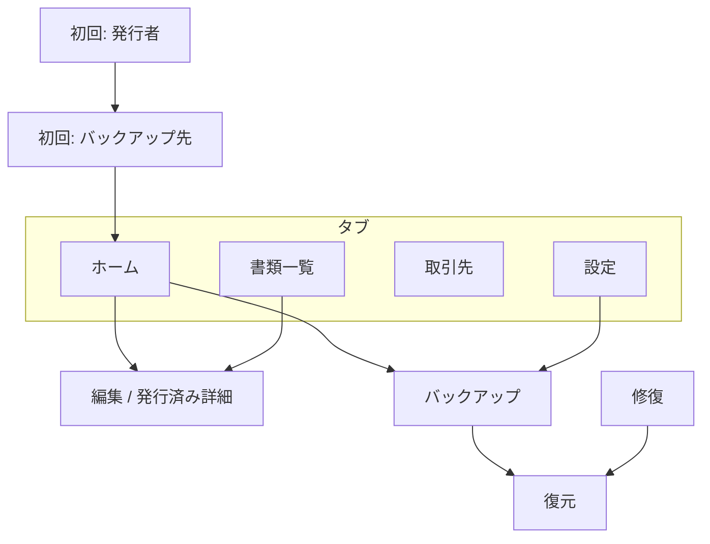

# UI 設計書（v1）

- 対象: `DESIGN.md` に定義されたオフライン請求・見積アプリ（Expo / iOS・Android）
- 位置づけ: 実装用のビジュアル・インタラクション仕様。本書はアプリソースを含まない
- 字体: 実装は `InvoiceJP`（Noto Sans JP サブセット）のみ。モックアップ HTML はオフラインのためシステム日本語ゴシックで近似する

---

## 1. デザインコンセプト

**「台帳の安心感を、毎日の3タップに圧縮する」**

1. **保全が見える** — ホーム常設のバックアップチップで、データの外への出口を色と文言で即読みさせる（緑・琥珀・赤）。
2. **数字は触らない錯覚** — 発行済みは編集 UI を消し、紙と同じ「読むだけ」レイアウトにする。下書きは明細と合計を同一画面で完結。
3. **法令の型を UI に焼く** — 税率別合計の切捨て説明、登録番号のゲート、A4 1枚拒否は「エラー」ではなく「発行できない理由」として正面から出す。

---

## 2. カラートークン

### 2.1 ライトモード

| トークン | 値 | 用途 |
| --- | --- | --- |
| `color.bg.canvas` | `#F4F5F7` | タブ画面の背景 |
| `color.bg.elevated` | `#FFFFFF` | カード、シート、ナビバー |
| `color.bg.subtle` | `#ECEEF2` | セグメント非選択、区切り帯 |
| `color.border.default` | `#D8DCE3` | 1px 枠、リスト区切り |
| `color.border.focus` | `#1D4ED8` | フォーカスリング（2px） |
| `color.text.primary` | `#111827` | 本文、金額 |
| `color.text.secondary` | `#4B5563` | 補助、ラベル |
| `color.text.tertiary` | `#6B7280` | プレースホルダ、メタ |
| `color.text.inverse` | `#FFFFFF` | 主ボタン上 |
| `color.brand.primary` | `#1D4ED8` | 主 CTA、リンク、選択タブ |
| `color.brand.primaryPressed` | `#1E40AF` | 主ボタン押下 |
| `color.brand.primarySubtle` | `#EFF6FF` | チップ背景（取引先） |
| `color.semantic.success` | `#047857` | バックアップ 24h 以内 |
| `color.semantic.successBg` | `#D1FAE5` | 成功チップ背景 |
| `color.semantic.warning` | `#B45309` | バックアップ 7日以内 |
| `color.semantic.warningBg` | `#FEF3C7` | 警告チップ背景 |
| `color.semantic.danger` | `#B91C1C` | 未バックアップ・失敗 |
| `color.semantic.dangerBg` | `#FEE2E2` | 危険チップ・バナー背景 |
| `color.semantic.info` | `#0369A1` | 情報バナー（例データ等） |
| `color.semantic.infoBg` | `#E0F2FE` | 情報バナー背景 |
| `color.doc.invoice` | `#1E3A5F` | 請求ラベル・アイコン |
| `color.doc.quote` | `#0F766E` | 見積ラベル |
| `color.doc.draft` | `#6B7280` | 下書き |
| `color.doc.voided` | `#9CA3AF` | 無効（打ち消し線） |
| `color.amount.positive` | `#111827` | 通常金額 |
| `color.amount.negative` | `#B91C1C` | 値引き行 |
| `color.overlay.scrim` | `rgba(17,24,39,0.45)` | モーダル背面 |

### 2.2 ダークモード

| トークン | 値 | 用途 |
| --- | --- | --- |
| `color.bg.canvas` | `#0F1115` | 背景 |
| `color.bg.elevated` | `#1A1D24` | カード、バー |
| `color.bg.subtle` | `#252932` | セグメント非選択 |
| `color.border.default` | `#3A404C` | 枠線 |
| `color.border.focus` | `#60A5FA` | フォーカス |
| `color.text.primary` | `#F3F4F6` | 本文 |
| `color.text.secondary` | `#9CA3AF` | 補助 |
| `color.text.tertiary` | `#6B7280` | メタ |
| `color.text.inverse` | `#0F1115` | 主ボタン上（明色ボタン時） |
| `color.brand.primary` | `#3B82F6` | 主 CTA |
| `color.brand.primaryPressed` | `#2563EB` | 押下 |
| `color.brand.primarySubtle` | `#1E293B` | チップ |
| `color.semantic.success` | `#34D399` | 成功文言 |
| `color.semantic.successBg` | `#064E3B` | 成功チップ |
| `color.semantic.warning` | `#FBBF24` | 警告文言 |
| `color.semantic.warningBg` | `#78350F` | 警告チップ |
| `color.semantic.danger` | `#F87171` | 危険 |
| `color.semantic.dangerBg` | `#7F1D1D` | 危険チップ |
| `color.semantic.info` | `#7DD3FC` | 情報 |
| `color.semantic.infoBg` | `#0C4A6E` | 情報バナー |
| `color.doc.invoice` | `#93C5FD` | 請求 |
| `color.doc.quote` | `#5EEAD4` | 見積 |
| `color.doc.draft` | `#9CA3AF` | 下書き |
| `color.doc.voided` | `#6B7280` | 無効 |
| `color.amount.positive` | `#F3F4F6` | 金額 |
| `color.amount.negative` | `#F87171` | 値引き |
| `color.overlay.scrim` | `rgba(0,0,0,0.6)` | スクリム |

### 2.3 色覚多様性

- **状態は色だけに依存しない**: バックアップチップは必ず文言（「バックアップ済」「要確認」「未設定」）と左端の形（● 実丸 / ◐ 半塗り / ○ 枠のみ）を併用する。
- **赤と緑の対のみで成功/失敗を伝えない**: 成功は緑＋「済」、警告は琥珀＋「要確認」、危険は赤＋「未設定」または「失敗」。
- **請求と見積**: 色に加え、先頭に漢字1文字ラベル（「請」「見」）を常時表示。
- **8% 軽減**: 品名先頭の `※` と、合計ブロック内の固定注釈文で識別。色だけで軽減を区別しない。
- **コントラスト**: 本文と背景は WCAG 2.1 AA（通常テキスト 4.5:1 以上）を目標。主ボタンは白文字 on `#1D4ED8`（ライト）／`#0F1115` on `#3B82F6`（ダーク）で 4.5:1 を満たす。
- **フォーカス**: キーボード／Switch Control 時は `border.focus` の 2px リングを全操作可能要素に付与。

---

## 3. タイポグラフィ

実装フォント: **InvoiceJP**（実質 Noto Sans JP サブセット、ウェイトは Regular のみ v1）。

| トークン | サイズ | 行送り | 用途 |
| --- | ---: | ---: | --- |
| `type.display` | 22px | 28px | 修復画面見出し |
| `type.title` | 20px | 26px | 画面タイトル（大） |
| `type.headline` | 17px | 22px | ナビタイトル、セクション見出し |
| `type.body` | 16px | 22px | 本文、フィールド値 |
| `type.bodyStrong` | 16px / semibold | 22px | 取引先名、合計ラベル |
| `type.subhead` | 14px | 20px | リスト副題、チップ内 |
| `type.caption` | 12px | 16px | 税注釈、タイムスタンプ |
| `type.micro` | 11px | 14px | バッジ、ハッシュ先頭表示 |
| `type.amountLg` | 20px / tabular | 26px | 合計（書類・編集） |
| `type.amountMd` | 17px / tabular | 22px | 行金額 |
| `type.tabular` | — | — | 金額列は `font-variant-numeric: tabular-nums` |

- **金額**: 常に `¥` プレフィックス、桁区切りは半角カンマ。マイナスは `−`（U+2212）＋金額。
- **日付**: `YYYY-MM-DD` 表示。和暦は v1 なし。
- **敬称**: 取引先名の直後に小さめ `type.subhead` で「御中」「様」。

---

## 4. スペーシングとレイアウト

| トークン | 値 | 用途 |
| --- | ---: | --- |
| `space.0` | 0 | — |
| `space.1` | 4px | チップ内 padding 縦 |
| `space.2` | 8px | 要素間最小 |
| `space.3` | 12px | リスト行内 |
| `space.4` | 16px | 画面水平マージン（標準） |
| `space.5` | 20px | セクション間 |
| `space.6` | 24px | カード内 padding |
| `space.8` | 32px | 大セクション |
| `radius.sm` | 8px | チップ、小ボタン |
| `radius.md` | 12px | カード、フィールド |
| `radius.lg` | 16px | シート上端 |
| `touch.min` | 44px | 最小タップ高さ（Apple HIG 準拠） |
| `tab.bar` | 49px + safe area | 下タブ |
| `nav.bar` | 44px + safe area | スタックヘッダ |

- **安全域**: 水平 `space.4`、下端はホームインジケータ上 `space.4`。
- **フッタ固定**: 編集画面の「発行して送る」はセーフエリア上に固定。スクロールはその上のみ。

---

## 5. コンポーネント仕様

### 5.1 Button（`components/Button.tsx`）

|  variant | 見た目 | 用途 |
| --- | --- | --- |
| `primary` | 塗り `brand.primary`、白文字、高さ 48px、`radius.md` | 請求書を作る、発行して送る、退避してから置き換える |
| `secondary` | 枠線 `border.default`、背景 elevated | 見積、あとで、キャンセル |
| `ghost` | 枠なし、`brand.primary` 文字 | 前回と同じ、リンク的操作 |
| `destructive` | 枠 `semantic.danger`、文字 danger | 無効にする（確認後） |

- `disabled`: 不透明度 0.45、タップ無効。`refuse` 時の発行ボタンは `disabled`＋直下に理由テキスト。
- ローディング: ラベルをスピナーに差し替え、幅は維持。

### 5.2 Field（`components/Field.tsx`）

- ラベル `type.subhead` + `text.secondary`、上余白 `space.3`。
- 入力: 高さ 48px、`radius.md`、背景 elevated、枠 1px。
- エラー: 枠 `semantic.danger`、下に `type.caption` でエラー文（例: 登録番号形式、禁止文字）。
- 文字数: 右下に `type.micro` で `visualLength / 上限`（編集時のみ）。

### 5.3 Confirm（`components/Confirm.tsx`）

- 中央カードまたは下寄せシート（発行確認は中央）。
- 主文 `type.bodyStrong`、副文 `type.subhead` `text.secondary`。
- ボタン横並び: 副操作 `secondary`、主操作 `primary`（右または下）。

### 5.4 BackupChip（`components/BackupChip.tsx`）

| 状態 | 背景 | 文言例 | 形状 |
| --- | --- | --- | --- |
| `ok_recent` | successBg | バックアップ済 · 今日 06:12 | ● |
| `ok_week` | warningBg | 要確認 · 3日前 | ◐ |
| `risk` | dangerBg | 未設定 · 端末のみ | ○ |
| `failed` | dangerBg | 失敗 · タップして確認 | ○ |

- タップで `backup.tsx`。高さ 36px、全幅またはコンテンツ幅。

### 5.5 TotalsBlock（`components/TotalsBlock.tsx`）

- 折りたたみなし。区分ごとに行: 「10%対象 税抜」「消費税(10%)」等。0 円バケットは行ごと非表示。
- 軽減行が1つでもあれば最下行に固定注釈: 「※は軽減税率（8%）の対象です。」
- その下 `type.caption`: 「税率ごとの税抜合計に対して、円未満を切り捨てています。」
- 最終行: 「合計」`type.amountLg`。

### 5.6 LineEditor（`components/LineEditor.tsx`）

- 1行: 品名（複数行可）、右に金額。軽減は品名先頭 `※`。
- タップで数量・単価シート（AmountKeypad）。
- 税率セグメント: `10%` | `8%` | `対象外`（高さ 36px）。
- スワイプ削除（iOS）、Android は行末ゴミ箱。
- 下: 品目チップ（横スクロール）+「空行を足す」。

### 5.7 AmountKeypad（`components/AmountKeypad.tsx`）

- 下シート、3×4 テンキー、右下確定。
- 数量モード: 小数1桁まで（ミリ変換は実装側）。単価モード: 整数円。

### 5.8 ClientSheet（`components/ClientSheet.tsx`）

- 下シート 70% 高さ。検索フィールド固定上。
- リスト: 取引先名 + 敬称、直近順。
- 末尾「この名前で追加」→ インライン Field。

### 5.9 ナビゲーション（タブバー）

4 タブ: **ホーム** / **書類** / **取引先** / **設定**。アイコンは線画 24px + `type.micro` ラベル。品目タブは無し。

### 5.10 リスト行（書類・取引先・品目）

- 高さ最小 64px。左: 種別バッジ、中央: 主テキスト＋副テキスト、右: 金額または chevron。
- 区切り: `border.default` 1px inset。

### 5.11 セグメントコントロール

- 書類一覧: すべて / 下書き / 請求 / 見積 / 無効
- 編集（下書きのみ）: 見積 | 請求
- 高さ 32px、`radius.sm`、選択は elevated + 下線 2px `brand.primary`

### 5.12 PDF プレビュー（編集フロー内）

- 発行前の確認用。A4 比率の白紙カード（幅いっぱい、影付き）。
- `refuse` 時: プレビュー領域に斜線パターン＋中央メッセージ「A4 の1枚に入りません。明細を減らすか、品名と備考を短くしてください。」発行ボタン disabled。

---

## 6. 画面フロー

| 画面 | ルート | 要点 |
| --- | --- | --- |
| 初回発行者 | `setup.tsx` | 屋号必須、登録番号は形式 OK のみ保存 |
| 初回バックアップ先 | 同上フロー | チェック必須の「あとで」 |
| ホーム | `(tabs)/index` | 作成 CTA、前回と同じ、バックアップチップ、下書き続き、直近書類 |
| 書類一覧 | `(tabs)/documents` | 5 セグメント、検索なし（v1） |
| 編集 | `editor/[id]` | 下書き編集 / 発行済み閲覧 |
| 取引先 | `(tabs)/clients` | 検索、編集、非表示 |
| 品目 | 設定内 | マスタ一覧のみ |
| 設定 | `(tabs)/settings` | 発行者、品目、期限ルール、バックアップ入口、データについて |
| バックアップ | `backup.tsx` | 状態、今すぐ、保存先、世代 |
| 復元 | `restore.tsx` | 自動選択済み1件、主ボタン1つ |
| 修復 | `repair.tsx` | 通常タブなし |

---

## 7. 画面別 UI 仕様

### 7.1 ホーム

**通常（例データあり）**

- 上: BackupChip（状態に応じた色）。
- 主: `Button primary`「請求書を作る」、横に `secondary` 小「見積」。
- `ghost`「前回と同じ」（直近発行済み請求があるときのみ）。
- 直近取引先チップ最大5（横スクロール）。
- 「続きから」下書き最大3（取引先名 · 種別 · 更新日）。
- 「直近の書類」3件リスト。

**空**

- イラストは置かない。
- 主ボタン2つのみ。
- 文言2行: 「データはこの端末の中にあります。」「バックアップファイルを自分のフォルダに残します。」

**バックアップ警告（赤チップ）**

- チップ下に `dangerBg` バナー（任意表示）: 「この端末を消すと、アプリ内のコピーも消えます。保存先を選んでください。」→ タップでバックアップ画面。

### 7.2 書類一覧

- セグメント5種。
- 行: 番号 or「下書き」、取引先、合計、発行日。
- **空**: 「書類がありません。ホームから請求書を作れます。」

### 7.3 編集（下書き・請求）

- ナビ: 戻る、中央「請求書」、右「プレビュー」。
- セグメント 見積|請求。
- 宛先タップ → ClientSheet。
- 件名、発行日、支払期限チップ（翌月末 / 今月末 / 14日後 / なし）。
- 明細リスト + LineEditor。
- TotalsBlock（10% / 8% / 対象外の内訳）。
- 備考 Field。
- フッタ: 「発行して送る」。
- 見積からコピー時: 情報バー「見積の金額は引き継いでいます。発行時に計算し直します。」

**発行済み**

- セグメントなし。フィールドは読み取り専用スタイル（背景 subtle）。
- フッタ: PDFを送る / 複製して下書き / （見積なら）請求書にする / （請求なら）無効にする。

### 7.4 PDF プレビュー

- スクロール可能な A4 プレビュー（モデル段階は表示しない。開発者向けは debug フラグのみ）。
- ツールバー: 閉じる、発行へ。

**1枚に収まらない（blocked）**

- プレビュー枠内に全面メッセージとイラストなしの禁止アイコン（枠線のみの A4 + 斜線）。
- 下部固定で理由文と「編集に戻る」。

### 7.5 取引先

- 検索バー上固定。
- 行: 名前、敬称、最終利用。
- スワイプ or メニューで非表示。
- **空**: 「取引先がありません。請求書を作るときに追加できます。」

### 7.6 品目（設定内）

- 単価（税抜）、単位、税率。
- **空**: 「品目がありません。編集画面で使った品目がここに残ります。」

### 7.7 設定 / 発行者

- グループリスト: 発行者情報、品目一覧、標準の支払期限、バックアップ、データについて。
- 発行者: 屋号、住所、電話、メール、登録番号、振込先（1欄）。
- 登録番号ヘルプ: 空欄可、形式 `T`+13桁。

### 7.8 バックアップ

- 現在状態（最終成功日時、保存先ラベル、journal エラーあれば表示）。
- `今すぐバックアップ` primary。
- 保存先を変更、世代リスト（日次・手動）。
- iCloud 選択時の警告文（設定から遷移時または初回）。

### 7.9 復元

- 選択中ファイル: 作成日時、取引先件数、書類件数、発行済み件数、ハッシュ先頭8文字。
- 主ボタン1つ「退避してから置き換える」。
- 副: 別のファイルを選ぶ（document picker）。
- エラーは `DESIGN.md` §6.5 の1文をそのまま表示（トーストまたはインライン）。

### 7.10 修復

- 全画面メッセージ、BackupChip なし、タブなし。
- 主ボタン「バックアップから復元」。

---

## 8. 空・エラー・バックアップ関連状態一覧

| ID | 画面 | 条件 | 表示 |
| --- | --- | --- | --- |
| E01 | ホーム | データなし | §7.1 空 |
| E02 | ホーム | 保存先未設定 | 赤チップ + バナー |
| E03 | 書類 | 0件 | 空文言 |
| E04 | 取引先 | 0件 | 空文言 |
| E05 | 品目 | 0件 | 空文言 |
| E06 | 編集 | 明細0 | 発行 disabled、「明細を1行以上追加してください」 |
| E07 | 編集 | chooseStage refuse | 発行 disabled + A4 文言 |
| E08 | Field | 禁止文字 | 欄下エラー |
| E09 | 発行確認 | 登録番号空 | 副文で適格でない旨 |
| E10 | 復元 | HASH_MISMATCH 等 | 設計書の固定文 |
| E11 | バックアップ | 直近失敗 | 赤チップ、画面内に error 列 |
| E12 | 非表示取引先 | 下書き参照中 | 確認「下書きの宛先欄は残ります」 |

---

## 9. アクセシビリティ（実装チェックリスト）

- すべての `Button`・リスト行に `accessibilityLabel`（日本語、金額は読み上げ用に「1234円」）。
- タブ: `accessibilityRole="tab"`、選択状態を明示。
- バックアップチップ: 色に加え `accessibilityHint` で最終日時を読む。
- 発行確認: フォーカストラップ、モーダル閉じるで戻る。
- 動きの削減: OS の「視差効果を減らす」に合わせ、シートアニメは 200ms 以下、オプションで即時表示（v1.1 検討。v1 は標準アニメのみ）。
- テキストサイズ: システムフォントスケール 200% まででレイアウトが崩れた場合、横スクロールを許容する画面（明細テーブルプレビュー）のみ `ScrollView` 横。

---

## 10. 却下した UI・ビジュアル案

| 案 | 却下理由 |
| --- | --- |
| ダッシュボード型ホーム（グラフ・売上） | `DESIGN.md` で分析・入金管理を v1 除外。保全と作成に集中 |
| 5タブに品目 | 採用 UX は編集内チップ + 設定内一覧 |
| 発行後のインライン編集 | 不変原則。ペンアイコンを出さない |
| 行ごとの消費税列 | 税計算仕様と適格表示に反する |
| パステル全面＋イラスト多め | フリーランスの業務ツールとして軽すぎ、空状態イラストも設計で禁止 |
| 和風・縦書き帳票 UI | テンプレート1つのモダン横書き。画面 UI も横書きゴシックで統一 |
| バックアップ状態を設定の奥だけ | ホーム常設チップを捨て、発見性が落ちる |
| 赤だけのエラー画面 | 色覚配慮。アイコン＋文言必須 |
| PDF 2ページ目のサムネ誘導 | 2ページは出さない。blocked 1状態のみ |
| 税込入力をメイン UI | v1 は税抜正本。品目フォームの補助のみ（画面モックでは主従を税抜表示） |
| ガラスモーフィズム多用 | 可読性・パフォーマンス。フラット + 軽い影1段 |
| カスタムアイコンフォント | 依存増。SF Symbols / Material Icons のシステムセット |
| 初回を5ステップオンボーディング | 発行者1 + バックアップ先1 の2画面のみ |

---

## 11. モックアップとの対応

| PNG | mockup.html の ID | 内容 |
| --- | --- | --- |
| 01-home | `#screen-home` | バックアップ済ホーム（例データ） |
| 02-documents | `#screen-documents` | 書類一覧 |
| 03-editor | `#screen-editor` | 請求下書き・明細・税率別合計 |
| 04-pdf-preview | `#screen-pdf-preview` | PDF プレビュー正常 |
| 05-pdf-blocked | `#screen-pdf-blocked` | A4 1枚拒否 |
| 06-clients | `#screen-clients` | 取引先 |
| 07-items | `#screen-items` | 品目 |
| 08-settings | `#screen-settings` | 設定・発行者 |
| 09-backup | `#screen-backup` | バックアップ |
| 10-restore | `#screen-restore` | 復元 |

モックアップ先頭に「例データ」帯を全画面共通で表示する。

---

## 12. 実装への引き継ぎ

- 色・字・間隔は `StyleSheet` 用に `theme/light.ts` / `theme/dark.ts` へトークン化することを推奨（v1 実装時）。
- PDF 画面上の字体は HTML 側 `InvoiceJP` のみ（モックアップは近似フォント）。
- コンポーネント名は `DESIGN.md` §7 と一致させる。
